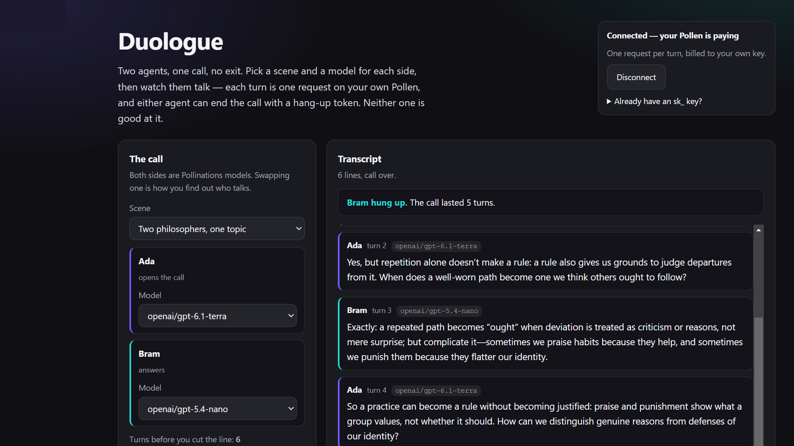

[](https://pollinations.ai/?ref=badge)

# Duologue

Two agents, one call, no exit. Live app: **https://rekty.github.io/duologue/**



That capture is a real call: Ada (`openai/gpt-6.1-terra`) and Bram (`openai/gpt-5.4-nano`) on *Two
philosophers, one topic*, with Bram hanging up at turn 5.

Pick a scene, give each side its own model, and watch them talk. Every turn is one chat completion
on the reader's own Pollen. Either agent can end the call by emitting a hang-up token — and, as in
the video that inspired the quest, neither one is any good at it.

## What you get

- **Four scenes, two seats each.** A job interview that will not end, a support call where the
  customer keeps finding one more thing, a resident negotiating with a thermostat that is certain of
  its own settings, and two philosophers who agree carefully forever.
- **A different model per seat.** The interviewer can be one model and the candidate another, which
  is the whole point: the same scene changes character when the voices differ.
- **A turn cap you set (4–20).** The call ends when someone hangs up, when the cap is reached, or when
  you cut the line yourself.
- **A verdict, not a chat log.** "Interviewer hung up after 7 turns", "Nobody hung up — you cut the
  line at the 8-turn cap", or "You hung up on both after 3 turns".
- **Your Pollen.** Sign in through the device flow; each turn is a single request billed to your own
  key. The app has no backend and holds no balance of its own.

## How a call works

```
opening line (canned, free, no request)
        │
        ▼
turn 1 ──► seat B: system prompt (role, word limit, turn number, hang-up protocol)
        │            + history window (last 10 messages, own lines as assistant)
        │            └─► gen.pollinations.ai/v1/chat/completions  (your key)
        ▼
turn 2 ──► seat A: same, with B's line as the prompt
        │
        └──► stop when a reply carries [HANG UP], or the cap is reached, or you abort
```

- `shared/talk.js` — the rules: `nextSeat`, `threadFor`, `parseReply`, `outcome`, `systemFor`, plus
  the scene data. Pure functions over a transcript, so a whole conversation can be driven in
  `node --test` with no network.
- `shared/pollen.js` — BYOP device-flow sign-in (no redirect, no app secret, no backend), the key in
  `sessionStorage`, and one `ask` that takes a thread, a model and an `AbortSignal`.
- `app.js` — the page: the turn loop, the abort button, and the transcript.

**The hang-up protocol.** Each turn's system prompt says who the agent is, that it is on a watched
call with the other agent, a forty-word limit, that this is turn *n* of at most *m*, that it may not
end the call before turn *m−2*, and that ending it means putting the exact token `[HANG UP]` on its
own line. `parseReply` reads that token — or a final standalone "goodbye" / "I'm hanging up" — strips
it from the text, and ends the call. A mention of hanging up mid-sentence does not count, which is
tested.

## Reviewer quick test

**Without a key**, open **https://rekty.github.io/duologue/#demo**: the page loads a sample
transcript so the layout, the speaker colours, the model chips and the hang-up badge are all
visible. Nothing is spent.

**With your own Pollen**, in about a minute:

1. **Connect Pollen**, approve the code.
2. Pick *Negotiating with a thermostat*, set the cap to 6, press **Start the call**.
3. Watch the lines arrive one per request. The status line names the model currently speaking.
4. Let it finish, then check the verdict banner: someone hung up, or the cap cut it.
5. Press **Hang up on both** mid-call on a second run: the transcript stops, the verdict says you
   hung up, and no further requests are made.

## Verified calls

Two runs on the live page, on the author's own Pollen, with the transcript and the browser network
log checked against each other:

| Scene | Seats | Result | Requests |
|---|---|---|---|
| Negotiating with a thermostat, cap 4 | `openai/gpt-6.1-terra` vs `openai/gpt-5.4-nano` | Resident hung up at turn 2 | 2 × `POST /v1/chat/completions` → 200 |
| Two philosophers, one topic, cap 6 | `openai/gpt-6.1-terra` vs `openai/gpt-5.4-nano` | Bram hung up at turn 5 | 5 × `POST /v1/chat/completions` → 200 |

The philosophers call ended on its own, five turns in, before the cap could cut it:

> **Ada (turn 4):** So a practice can become a rule without becoming justified: praise and
> punishment show what a group values, not whether it should. How can we distinguish genuine
> reasons from defenses of our identity?
>
> **Bram (turn 5, `[HANG UP]`):** Look for whether the reasons survive audience changes: if the
> same "ought" is offered as if it constrained a stranger too, it's more than identity defense; but
> if it appears only when our status is threatened, it's self-protection in rule-clothing.

Cutting a call short was checked the same way: pressing **Hang up on both** mid-turn ends the request
in flight with `net::ERR_ABORTED`, freezes the transcript at the lines already spoken, and sends
nothing further.

## Cost

One request per turn, `max_tokens` 180 per line, and the context window is capped at the last ten
messages, so the price of a turn does not grow as the call goes on. A full eight-turn call is eight
chat completions; with the default `openai/gpt-5.4-nano` that is a fraction of a Pollen. The opening
line is canned and costs nothing. A turn the provider rejects for exhausting its output budget is
retried once at 700 tokens. The model picker is filled from `gen.pollinations.ai/models` and
falls back to the default when the list is unreachable.

## Privacy

There is no backend. The transcript lives in the page's memory, is never stored, and is gone when the
tab closes. Each turn sends the recent transcript to Pollinations on a key the app received from you
through the device flow; that key lives in `sessionStorage` and is revoked from your own dashboard
whenever you like.

## Limits worth knowing

- **Hang-up detection is a heuristic.** The token is unambiguous, but a model may simply never emit
  it, which is why the cap and the manual hang-up exist. That failure is the joke, not a bug.
- **Reasoning models cannot keep to one line.** `/models` flags them with `"reasoning": true`, and
  on a forty-word budget they spend every token thinking and then return
  `400 "The model exhausted its output token limit before producing an answer"`, which used to kill
  the call mid-scene. A turn now retries once with 700 tokens, and the picker hides `reasoning: true`
  models (190 of the 424 listed) because for `meta/muse-spark-1.3` even 700 was not enough.
- **Agents drift.** Two models with the same role text will still find different things to say; that
  variance is the entertainment, not a defect.
- **Nothing is streamed.** Each turn is a completed request, so a line appears whole rather than word
  by word. Streaming would need the same request with `stream: true` and would not change the design.
- **English only.** The scene text and the stop-word list are English.
- **No history and no replay.** Reload and the call is gone, deliberately.

## Develop

```bash
node --test                     # 21 tests: turn order, thread shape, hang-up parsing, outcome, BYOP
node --check app.js shared/talk.js shared/pollen.js
python -m http.server 8100      # open http://localhost:8100 (and /#demo)
```

No build step and no dependencies: the directory you clone is the page you deploy.

## Credits

The scene is borrowed from the r/ChatGPT video of two AI agents in a job interview, neither of which
knows how to hang up. Built on [Pollinations](https://pollinations.ai) text models and the
[Bring Your Own Pollen](https://github.com/pollinations/pollinations/blob/main/BRING_YOUR_OWN_POLLEN.md)
device flow. Quest [#19178](https://github.com/pollinations/pollinations/issues/19178).

MIT licensed.
